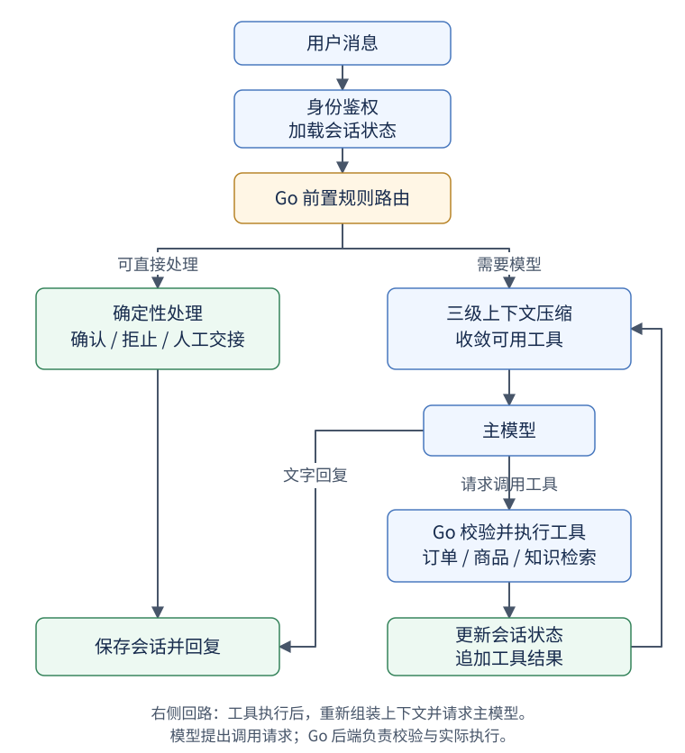

# OrderPilot · 电商订单智能客服 Agent

基于 **Go + Iris** 的可运行电商客服项目：模型理解用户问题，后端执行商品、订单和知识检索操作；通过结构化会话状态、二次确认和权限校验，处理长对话中的订单指代与取消操作。

项目重点是 **客服 Agent 的可靠编排、上下文压缩及可核验评测**，同时提供用户/商品/订单页面、MySQL 事务、Redis 缓存和自动化测试。支持无模型 Key 的本地演示，以及 Grok / OpenAI-compatible 主模型。官方 TypeSafe Jev 是可选实验能力，不是运行前提。

## 导航

- [客服能力](#客服能力)
- [请求处理流程](#请求处理流程)
- [三级上下文压缩](#三级上下文压缩)
- [运行与配置](#运行与配置)
- [真实评测与压测](#真实评测与压测)
- [接口与代码入口](#接口与代码入口)
- [测试和已知边界](#测试和已知边界)

## 客服能力

| 能力 | 实现与安全边界 |
| --- | --- |
| 查询商品、低库存商品 | `search_products`，由业务服务查询，不是模型编造库存 |
| 查询本人订单列表 | `list_my_orders`，身份来自后端鉴权，不接受模型指定用户 |
| 查询订单状态 | `get_order_status`，业务层再次校验归属 |
| 申请取消订单 | `prepare_cancel_order`，只准备确认操作，不立即修改订单 |
| 用户确认取消 | 后端验证单次、5 分钟有效且绑定用户/会话的令牌，再执行取消返库事务 |
| 售后和配送政策问答 | `search_knowledge`；支持 BM25 和可选 Embedding + pgvector + RRF |
| 失败与人工转接 | 显式投诉、重复调用、业务终态错误等返回结构化交接信息 |

“转人工”目前是返回交接信息，尚未接入真实坐席平台；不提供支付退款、实际退货、修改地址、发票或物流轨迹查询接口。知识库为模拟电商政策，不是实际商户承诺。

## 请求处理流程



[打开完整流程图](docs/images/agent-request-flow.svg)

| 前置规则命中 | 后端处理 |
| --- | --- |
| 有效待确认操作，用户明确确认或放弃 | 核销或清理令牌，直接回复 |
| 越权风险或已知终态重复操作 | 拒止并说明原因 |
| 投诉或业务处理失败 | 返回人工交接信息 |
| 需要模型理解与回答 | 压缩上下文、收敛工具后调用主模型 |

模型只提出调用请求，Go 真正执行功能；工具执行后更新状态，避免把模型声称“已取消”当成业务事实。

### 规则路由与官方 Jev

默认开启 **Go 确定性规则路由**，借鉴“先决策、再调用高成本模型”的思路：

- 有效待确认状态 + 明确确认/放弃：后端直通，无需主模型。
- 已知终态订单重复取消、已知订单候选之外的指定订单、身份注入词：前置拒止，执行层仍检查权限。
- 已查明没有订单且要求取消/退款/退货：直接拒止。
- 投诉、连续业务失败且仍要求取消/退货、超出能力：转人工或进入兜底。
- 普通明确请求：按意图筛选工具，再进入主模型。

可选 **官方 TypeSafe Jev** 使用原生 `/v1/systemone` 和独立 Key，仅在指代、多意图等触发条件满足时调用。它通过 Choice/Noul 返回候选标签及概率，不能生成任意订单号，不执行取消。失败或不确定时回退主模型。详见 [接入说明](docs/typesafe-integration.md)。

**目前未证明官方 Jev 额外提速**：最近三组实验中，相比规则版，外部 Jev 合计输入增加 7.22%，观测平均延迟增加 27.68%，业务完成率均为 2/2。因此示例默认关闭外部 Jev，保留可选实现和完整证据。

## 三级上下文压缩

1. **状态锚定**：Go 将真实工具结果更新到 `SessionState`，注入本人订单、可取消/终态订单、关注商品和待确认状态。真实确认 Token 不进入模型上下文。
2. **历史工具载荷脱水**：较早订单/商品 JSON 保留白名单字段；历史 RAG 保留标题和归档说明。最新含工具结果的轮次通常完整保留，失败结果不按成功载荷删字段；原始会话记录不被覆盖。
3. **安全窗口与 Token 裁剪**：先保留最近最多 6 个用户轮次，再按完整 `messages + tools` 本地预算进一步缩减。切分点位于用户消息边界，请求和工具结果一起保留或移除。早期诉求、数字候选和已答复结论通过代码提取成摘要，不额外调用模型。

例如历史订单保留 `orderId`、`productId`、`status`、`canCancel`、`price` 等字段，删除附加描述。用户问到已删除的实时信息时要重新查询；没有相应接口就说明能力边界，不能猜测。

固定编码对请求 JSON 的本地计数与 Provider 计费 Token 不保证一致。现有计数失败仍有估算回退，极小预算也有紧急降级路径，不能宣称全部路径都满足生产级硬预算。详见 [性能报告](docs/customer-service-performance.md)。

## 运行与配置

### 1. 无模型 Key 的本地演示

要求 Docker Compose；本机开发需要 Go **1.26.9+**，以 [go.mod](go.mod) 为准。

```bash
cp .env.example .env
docker compose up -d --build --wait
```

Windows 使用 `Copy-Item .env.example .env`。示例 Key 留空时使用本地确定性 Provider，不产生模型费用。演示账号为 `demo / demo123456`；部署前修改密码和 `AUTH_SECRET`。

| 地址 | 用途 |
| --- | --- |
| http://localhost:8080/user | 登录 |
| http://localhost:8080/agent | 客服对话、调用轨迹、取消确认 |
| http://localhost:8080/order | 订单管理 |
| http://localhost:8080/product/all | 商品管理 |
| `GET /health`、`GET /ready` | 存活与数据库就绪检查 |

### 2. 接入真实主模型

在 `.env` 填自己的服务端配置，不提交真实 Key：

```dotenv
AI_PROVIDER=grok
AI_BASE_URL=https://api.x.ai/v1
AI_MODEL=填写账号可用的模型ID
XAI_API_KEY=填写自己的Key
# 其他兼容网关可使用 AI_API_KEY。
AGENT_JEV_ENABLED=true
AGENT_JEV_SHADOW=false
JEV_EXTERNAL_ENABLED=false
AGENT_CONTEXT_STRATEGY=ours_full
AGENT_CONTEXT_TOKEN_BUDGET=12000
AGENT_TOKEN_ENCODING=cl100k_base
AI_PROVIDER_MAX_RETRIES=0
```

Compose 会读取 `.env` 做替换，但只向容器传入 `environment` 明确列出的变量；扩展前请核对 [docker-compose.yml](docker-compose.yml)。**直接 `go run ./backend` 不会自动加载 `.env`**，需先设置进程环境变量。主模型、Embedding、TypeSafe 使用各自配置，不应混用凭据。

### 3. 本机 Tokenizer 服务

```bash
python -m pip install -r tests/requirements-context.txt
python tokenizer/server.py
```

另一个终端设置 `AGENT_TOKENIZER_URL=http://127.0.0.1:8091` 后启动本机 Go 后端。计数服务支持 `GET /healthz`、`POST /v1/count`。不配置常驻服务时可使用 Python 子进程计数，但重复计数开销更高。

当前 Tokenizer 只监听回环地址，Compose 尚未编排它；**容器里的 127.0.0.1 不是宿主机**。不要将本机步骤直接当作容器严格 Token 部署。pgvector/Embedding 可选，不配置时使用本地检索；生产适配器的向量维度、DSN 和模型需一致。

## 真实评测与压测

各实验数据不可混成“线上综合提升”。分母、原始记录、环境及复现方式见 [客服评测与性能报告](docs/customer-service-performance.md)。

### 检索与上下文实验

| 实验 | 实测结果 | 口径和证据 |
| --- | --- | --- |
| 检索冻结集 | RRF Recall@3 **88.1%**，BM25 79.9%，向量 85.1% | 75 题中 67 条可回答、32 篇模拟政策；[报告](docs/retrieval-v2-results.md) |
| 历史挑战集 | 工具路径 **27/30（90%）**，整体自动通过 **22/30** | 固定题集单次真实模型运行；[报告](docs/challenge-eval-results.md) |
| 8 轮历史 E2E 消融 | 完整历史→压缩+规则，累计输入 **降低 57.90%**，Turn6+ 单请求峰值 **降低 66.07%** | 4 场景中 3 条完整配对；[报告](docs/strict-core4-v3-resumed/final-resumed-report.md) |

57.90% 是压缩和规则的组合收益；同实验关闭路由时，纯压缩累计输入下降 52.24%。历史组合版完整配对子集业务完成 3/3，但严格全轨迹仅 1/3；全 4 条业务完成 3/4，含一次模型服务中断，不能概括为全面无损或总体准确率 100%。

### 官方 Jev 三组真实调用实验

同两条 8 轮对话、相同主模型、固定 Mock 业务工具，串行自由运行；不是生产流量或并发压测。

| 方案 | 主模型+Jev 输入合计 | 每用户轮平均响应 | 业务完成 | 工具执行成功 |
| --- | ---: | ---: | ---: | ---: |
| 三级压缩 | 77,431 Token | 5.633s | 2/2 | 16/16 |
| 三级压缩 + Go 规则 | 65,847 Token | 7.301s | 2/2 | 17/17 |
| 三级压缩 + Go 规则 + 官方 Jev | 70,598 Token | 9.322s | 2/2 | 16/16 |

工具执行成功不等于选择准确，规则组严格工具路径及参数命中为 15/16。官方 Jev 调用 5 次、采用 2 次、回退 3 次，全部消耗计入。证据：[结论](docs/typesafe-efficiency-v1/findings.md)、[逐轮报告](docs/typesafe-efficiency-v1/report.md)、[Checkpoint](docs/typesafe-efficiency-v1/checkpoint.json)。

### 本地 HTTP 并发压测

真实 Iris 控制器 + 鉴权 + Agent + 本地 Provider，覆盖政策检索与人工短路；并发 1/8/32，各 10,000 请求，共 **60,000** 请求，校验回复状态和工具结果。**不含远程模型、数据库、Redis、真实 Tokenizer 或长会话，不代表生产容量。**

结果、环境和限制见 [本地压测报告](docs/customer-service-performance.md#本地-http-并发压测)，原始数据见 [agent-local-load.json](docs/agent-local-load.json)。不要把本地毫秒延迟与真实模型秒级延迟混用。

## 接口与代码入口

客服 JSON 接口使用登录返回的 `Authorization: Bearer <token>`：

| 接口 | 用途 |
| --- | --- |
| `POST /agent/chat` | `{"message":"我的订单有哪些？","conversationId":"可省略"}` |
| `POST /agent/confirm` | 提交响应中的 `conversationId` 和确认 `token` |
| `POST /agent/reset` | `{"conversationId":"..."}` |
| `GET /agent/status` | 当前 Provider、模型和模式 |
| `GET /agent/metrics` | 请求、工具、Token 与路由计数 |

```text
agent/service.go             主编排、工具执行、压缩、确认
agent/session_state.go       状态更新、锚点、序列化
agent/jev_router.go          Go规则、官方Jev触发与回退
agent/typesafe_client.go     官方Jev原生概率决策接口
agent/compatible_provider.go 主模型接口、计数、重试、usage
agent/redis_guard.go         状态、限流、去重、原子令牌处理
agent/rag*.go               知识检索和生产适配器
backend/                    Iris、控制器和客服页面
services/ repositories/     商品订单业务与数据访问
tokenizer/                  常驻tiktoken服务
tests/                      接口/数据库测试、评测辅助脚本
docs/                       架构、评测报告与原始证据
```

## 测试和已知边界

建议先启动本机 Tokenizer。以下 PowerShell 命令不加载 `.env`，显式使用本地模型；不要在已启用付费评测开关的终端运行全测试。

```powershell
$env:AI_PROVIDER='local'
$env:JEV_EXTERNAL_ENABLED='false'
$env:AGENT_TOKENIZER_URL='http://127.0.0.1:8091'
$env:AGENT_ABLATION_REPORT_PATH='../docs/local-verification-ablation.md'
go test ./... -count=1 -timeout 5m
go test ./agent -run '^TestTypeSafeEfficiencyEvidenceOffline$' -count=1 -v
go vet ./...
go build ./...

# 本地HTTP压测，无付费模型调用。
$env:AGENT_LOCAL_LOAD='1'
go test ./backend/web/controllers -run '^TestAgentLocalHTTPLoad$' -count=1 -v -timeout 3m
```

MySQL 并发防超卖/幂等集成测试需设置 `INTEGRATION_TEST=1`；HTTP 冒烟运行 `python tests/api_smoke_test.py`；浏览器测试使用 `npm ci`、`npx playwright install chromium`、`npm run test:e2e`。完整说明见 [tests/README.md](tests/README.md) 与 [CI](.github/workflows/api-smoke.yml)。线上评测必须显式开启，不应为了生成文档重复调用模型。

当前限制：摘要为规则提取，数字可能误识别；已知订单候选不等于完整归属证明；Chat 尚未实际检索赋值 RAG 预检分数；同会话并发写入并非线性一致；完整消息仍在内存，Redis 状态快照不能恢复全部跨重启对话；尚无线上模型并发吞吐或 SLA 结论。详见 [工程边界](docs/customer-service-performance.md#已知工程边界)。

更多：[Agent 设计](docs/agent-design.md) · [整体架构](docs/architecture.md) · [OpenAPI](docs/openapi.yaml) · [数据库迁移](db/migrations/README.md)
